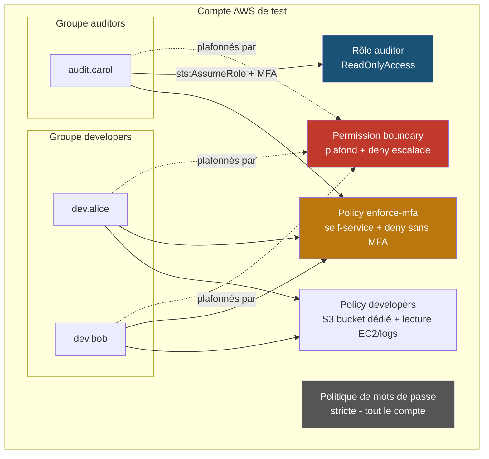

# Cloud IAM Security Lab — AWS IAM au moindre privilège avec Terraform

Lab de sécurité **Identity and Access Management (IAM)** sur AWS, entièrement décrit en **Infrastructure as Code** avec Terraform. L'objectif est de démontrer, de façon reproductible, les bonnes pratiques de contrôle d'accès dans le cloud : **moindre privilège**, **MFA obligatoire**, **permission boundaries** anti-escalade et **accès temporaire par assume-role**.

> ⚠️ **Projet à but pédagogique.** Déployer ce lab crée de vraies ressources IAM dans votre compte AWS. IAM est gratuit, mais les identités créées sont réelles : utilisez un **compte de test** et détruisez le lab (`terraform destroy`) à la fin.

---

## Objectifs pédagogiques

- Écrire des politiques IAM **customer managed** au moindre privilège plutôt que d'utiliser les politiques AWS trop larges (`AdministratorAccess`).
- Imposer l'**authentification multi-facteurs (MFA)** avant toute action sensible.
- Confiner les identités avec une **permission boundary** qui bloque l'escalade de privilèges.
- Mettre en place un **rôle temporaire** (assume-role) pour l'audit en lecture seule.
- Gérer les droits **par groupe** et non directement par utilisateur.
- Durcir le compte via une **politique de mots de passe** stricte.

---

## Architecture du lab



---

## Prérequis

| Outil | Version conseillée | Rôle |
|---|---|---|
| [Terraform](https://developer.hashicorp.com/terraform/downloads) | ≥ 1.5 | Provisionnement de l'infrastructure |
| [AWS CLI](https://aws.amazon.com/cli/) | v2 | Authentification et tests manuels |
| Compte AWS | — | **De test**, avec des droits IAM administrateur pour appliquer le lab |

Configurez vos identifiants avant de commencer :

```bash
aws configure
# ou export AWS_ACCESS_KEY_ID / AWS_SECRET_ACCESS_KEY / AWS_DEFAULT_REGION
```

---

## Structure du dépôt

```
cloud-iam-security-lab/
├── README.md
└── terraform/
    ├── versions.tf              # Versions Terraform + provider AWS
    ├── variables.tf             # Variables d'entrée
    ├── main.tf                  # Données du compte + politique de mots de passe
    ├── policies.tf              # Politiques IAM (MFA, boundary, developers, auditors)
    ├── groups.tf                # Groupes IAM + rattachement des politiques
    ├── users.tf                 # Utilisateurs IAM (avec permission boundary)
    ├── roles.tf                 # Rôle auditeur en lecture seule (assume-role + MFA)
    ├── outputs.tf               # Sorties (ARN, noms d'utilisateurs, etc.)
    └── terraform.tfvars.example # Exemple de configuration
```

---

## Contrôles de sécurité implémentés

| # | Contrôle | Fichier | Principe |
|---|---|---|---|
| 1 | **Politique de mots de passe** | `main.tf` | 14 caractères min, complexité, rotation 90 j, anti-réutilisation (24) |
| 2 | **MFA obligatoire** | `policies.tf` | Self-service des identifiants autorisé, tout le reste refusé sans MFA |
| 3 | **Permission boundary** | `policies.tf` + `users.tf` | Plafonne les droits effectifs et **bloque l'escalade de privilèges** |
| 4 | **Moindre privilège (developers)** | `policies.tf` | S3 limité à un bucket dédié + observabilité en **lecture seule** |
| 5 | **Gestion par groupe** | `groups.tf` | Politiques attachées aux groupes, jamais directement aux utilisateurs |
| 6 | **Accès temporaire (auditors)** | `roles.tf` | Rôle `ReadOnlyAccess` assumable **uniquement en MFA**, session 1 h |

### Pourquoi une permission boundary ?

Une *permission boundary* ne donne aucun droit : elle définit le **maximum** qu'une identité peut obtenir. Dans ce lab, même si un développeur se voyait attacher par erreur `AdministratorAccess`, ses droits effectifs resteraient l'**intersection** de ses politiques et de la boundary — donc toujours sans possibilité de créer des utilisateurs, d'attacher des politiques ou de modifier sa propre boundary (`DenyPrivilegeEscalation`).

---

## Déploiement

```bash
cd terraform

# 1. Initialiser le provider AWS
terraform init

# 2. (Optionnel) personnaliser les variables
cp terraform.tfvars.example terraform.tfvars
#   puis éditez terraform.tfvars

# 3. Visualiser le plan SANS rien créer (recommandé pour l'étude)
terraform plan

# 4. Appliquer
terraform apply
```

> 💡 Pour **étudier le lab sans rien déployer**, `terraform plan` suffit : il valide la syntaxe, résout les variables et affiche le JSON des politiques générées.

---

## Scénarios de test

Après `terraform apply`, créez un mot de passe/clé pour un utilisateur de test et vérifiez le comportement attendu :

| Scénario | Commande (en tant que `dev.alice`) | Résultat attendu |
|---|---|---|
| Action **sans MFA** | `aws ec2 describe-instances` | ❌ `AccessDenied` (bloqué par `enforce-mfa`) |
| Enrôler un périphérique **MFA** | `aws iam create-virtual-mfa-device ...` | ✅ Autorisé (self-service) |
| Action **avec MFA** (session STS) | `aws ec2 describe-instances` | ✅ Autorisé |
| Écrire **hors** du bucket dédié | `aws s3 cp f s3://autre-bucket/` | ❌ `AccessDenied` (moindre privilège) |
| Tenter une **escalade** | `aws iam create-user ...` | ❌ `AccessDenied` (permission boundary) |
| Assumer le **rôle auditeur** sans MFA | `aws sts assume-role ...` | ❌ `AccessDenied` (trust policy) |

> Pour obtenir une session MFA : `aws sts get-session-token --serial-number <arn-mfa> --token-code <code>`.

---

## Nettoyage

```bash
cd terraform
terraform destroy
```

Toutes les ressources créées étant taguées `Project = iam-lab`, vous pouvez aussi les auditer dans la console IAM avant suppression.

---

## Bonnes pratiques illustrées (et au-delà)

| Bonne pratique AWS | Statut dans le lab |
|---|---|
| Désactiver / ne pas utiliser le compte **root** au quotidien | Recommandé (hors scope IaC) |
| Appliquer le **moindre privilège** | ✅ Politiques customer managed scoping fin |
| **MFA** pour les identités humaines | ✅ Imposé par politique |
| **Permission boundaries** pour déléguer sans risque | ✅ Appliquées aux utilisateurs IAM |
| Privilégier les **rôles temporaires** aux clés longues durée | ✅ Rôle auditeur assume-role |
| **Rotation** des identifiants | ✅ Politique de mots de passe (90 j) |
| **Journalisation** des appels API (CloudTrail) | 🔜 Extension possible |

### Pistes d'extension

- Ajouter **CloudTrail** + un bucket S3 chiffré pour l'audit des appels API.
- Détecter les politiques trop permissives avec **IAM Access Analyzer**.
- Intégrer une analyse statique de sécurité IaC (**tfsec**, **Checkov**) en CI.

---

## Avertissement

Ce dépôt est fourni à des fins **éducatives**. Les noms d'utilisateurs, buckets et valeurs par défaut sont fictifs. Vérifiez toujours un `terraform plan` avant d'appliquer dans un compte AWS, et n'exécutez ce lab que sur un environnement de test dont vous êtes responsable.

---

*Projet réalisé dans le cadre de l'apprentissage de la sécurité cloud — IAM & Infrastructure as Code.*
